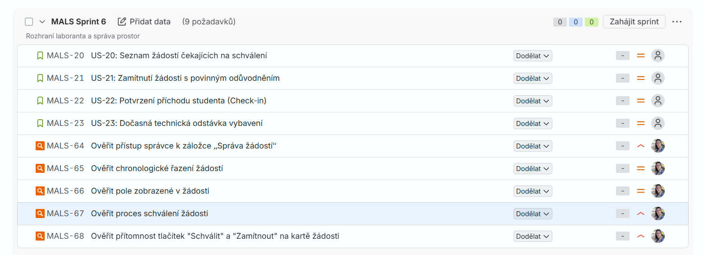
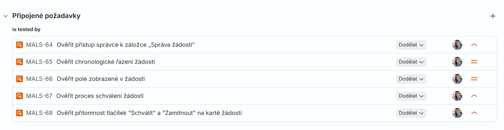

# 📋 Tvorba Test Cases na základě dokumentace v Jira
 
V Jira jsem zpracovala požadavky z dodané dokumentace a rozdělila je podle jednotlivých oblastí do sprintů. V této ukázce prezentuji Sprint 1 – Přihlašování, bezpečnost a profil uživatele.
V Jira jsem vytvořila Story, které obsahuje user story a akceptační kritéria, které byly uvedeny v dokumentaci.
 

## 🔍 Test Case 1

### 🧪 US-01: Přihlášení univerzitním e-mailem
 

#### User Story:

Jako student nebo vyučující, chci se do aplikace přihlašovat pomocí své univerzitní e-mailové adresy a hesla, abych získal přístup k rozvrhu laboratoří podle svých oprávnění.

#### Akceptační kritéria:

1. Přihlašovací obrazovka obsahuje pole „Univerzitní e-mail“, „Heslo“, tlačítko „Přihlásit se“ a odkaz „Zapomenuté heslo?“.
2. Při zadání nepovolené domény (např. běžný @gmail.com, pokud univerzita vyžaduje tvar @univerzita.cz) se zobrazí upozornění: „Použijte oficiální univerzitní e-mailovou adresu“.
3. Při zadání nesprávného hesla se zobrazí chybová zpráva: „Nesprávný e-mail nebo heslo“. Vyplněný e-mail zůstává zachován.
4. Po třech neúspěšných pokusech se tlačítko pro přihlášení dočasně zablokuje na 30 sekund.
5. Po úspěšném přihlášení se relace uloží na zařízení a uživatel je přesměrován na hlavní obrazovku katalogu.
 

### 🗂️ Ukázka položek Sprintu 1

Na základě user story a akceptačních kritérií jsem navrhla test cases, které jsem zpracovala pomocí nástroje QAlity Plus v Jira. U jednotlivých test cases jsem definovala předpoklady (preconditions), testovací kroky, testovací data a očekávané výsledky.

Test case jsem následně propojila s příslušnou user story, aby byla zachována dohledatelnost mezi požadavky a navrženými testy (traceability).
 

### 🔗 Připojené požadavky v  Jira k US-01: Přihlášení univerzitním e-mailem

 
 

### 🧪 Test Cases v QAlity Plus k US-01: Přihlášení univerzitním e-mailem
 

Níže uvádím jako ukázku detail test case MALS-26 – Ověřit přihlášení platnými přihlašovacími údaji.

 

 

 
 

 

## 🔍 Test Case 2

### 🧪 US-20: Seznam žádostí čekajících na schválení

#### User Story:

Jako laborant / správce, chci mít přehledný seznam příchozích žádostí o přístup ke svěřenému vybavení, abych mohl posoudit účel práce studentů a včas jim potvrdit vstup.

#### Akceptační kritéria:

1. Správce má v aplikaci k dispozici záložku „Správa žádostí“.

2. Žádosti jsou řazeny chronologicky a obsahují: jméno studenta, ročník/obor, vybraný přístroj a text uvedený jako cíl práce.

3. Na každé kartě jsou dvě hlavní tlačítka: „Schválit“ (zelené) a „Zamítnout“ (červené).

4. Po stisknutí „Schválit“ se stav rezervace změní na „Potvrzeno“ a student obdrží oznámení.

### 🗂️ Ukázka položek Sprintu 6

### 🔗 Připojené požadavky v  Jira k US-20: Seznam žádostí čekajících na schválení

 
 

### 🧪 Test Cases v QAlity Plus k US-20: Seznam žádostí čekajících na schválení
 

