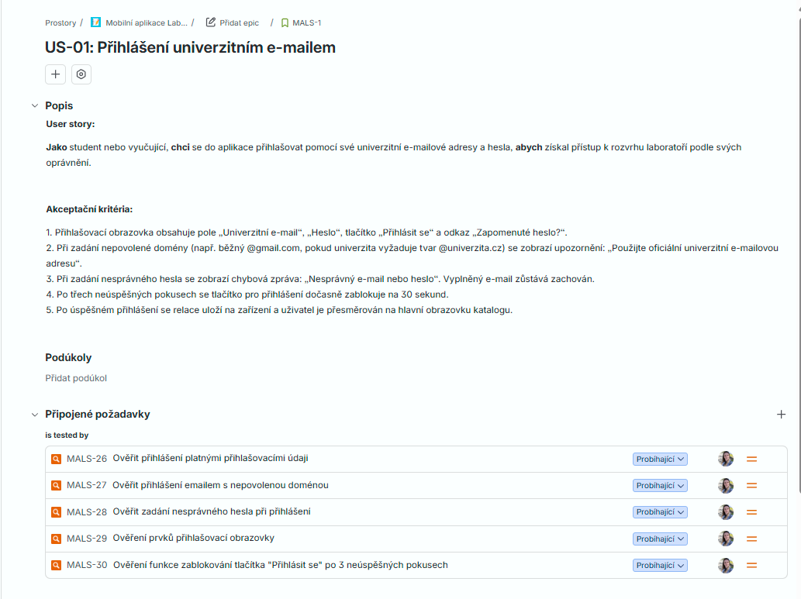

### ✅ Test Cases

**US-01: Přihlášení univerzitním e-mailem**
**User story:**

Jako student nebo vyučující, chci se do aplikace přihlašovat pomocí své univerzitní e-mailové adresy a hesla, abych získal přístup k rozvrhu laboratoří podle svých oprávnění.

**Akceptační kritéria:**

1. Přihlašovací obrazovka obsahuje pole „Univerzitní e-mail“, „Heslo“, tlačítko „Přihlásit se“ a odkaz „Zapomenuté heslo?“.
2. Při zadání nepovolené domény (např. běžný @gmail.com, pokud univerzita vyžaduje tvar @univerzita.cz) se zobrazí upozornění: „Použijte oficiální univerzitní e-mailovou adresu“.
3. Při zadání nesprávného hesla se zobrazí chybová zpráva: „Nesprávný e-mail nebo heslo“. Vyplněný e-mail zůstává zachován.
4. Po třech neúspěšných pokusech se tlačítko pro přihlášení dočasně zablokuje na 30 sekund.
5. Po úspěšném přihlášení se relace uloží na zařízení a uživatel je přesměrován na hlavní obrazovku katalogu.

Pokrytí cesty

